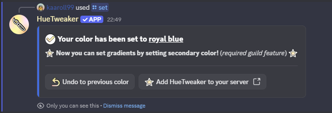

# set


Without a vote you can change your color **2 times per 30 minutes**. During the first 12 hours after the bot joins a server there's no limit. [Voting on top.gg](../main/voting.md) removes this limit for 12 hours.


Set or change your username color. The bot shows a preview and applies the color after you press **Accept**.

**Syntax:** `/set <color>`

`<color>` can be any [color format](../main/colors.md#color-formats): HEX, CSS name, rgb/hsl/cmyk, `random`, `@user`, or a gradient preset name like `sunset`.

**Examples:**

* `/set f5df4d`
* `/set royalblue`
* `/set @kaaroll99`
* `/set random`

**Good to know:**

* The first time, the bot creates a role named `🎨 <your display name>`. The name updates every time you change your color.
* **☀️ Lighter** / **🌙 Darker** on the preview change the color by 10% before you accept. Pressing them doesn't count toward the free limit; only **Accept** does.
* **Undo** in the result message brings back your previous color.
* **⭐ Save to favorites** in the result message adds the color to your [favorites](favorites-list.md).
* On a boosted server, **🌈 Make it a gradient** shows gradients that start with your new color (to its neighbours on the color wheel, its opposite, and a lighter shade). Setting one needs a [vote](../main/voting.md), like [`/gradient`](gradient.md).
* If a higher colored role covers your new color, the result names that role and how an admin can fix it ([details](../main/troubleshooting.md#my-color-doesnt-show)).
* Under the result there's a short tip about another feature, such as [`/match`](match.md), [`/favorites add`](favorites-add.md) or, on a boosted server, [`/gradient`](gradient.md).
* Only accepted changes count toward the free limit. Cancelling or pressing **Undo** doesn't.
* A preset name, or copying a user with a gradient or the holographic style, sets the whole style. That needs the same as [`/gradient`](gradient.md): Server Boost and a vote.
* For two colors, use [`/gradient`](gradient.md).
* Shortcut: right-click a member (or tap their profile on mobile) → **Apps** → **Copy color** does the same as `/set @user`.
* Cooldown: 10 seconds.

***

## Bot response

<figure><figcaption></figcaption></figure>

<figure><figcaption></figcaption></figure>

